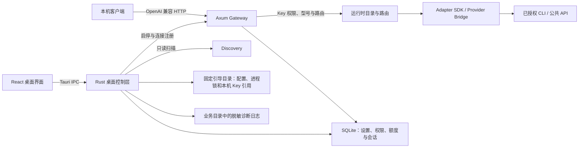

# LocalAiMux 架构总览

LocalAiMux 是一个 Tauri 2 桌面进程。React 通过 Tauri IPC 管理应用发现、显式连接、API 启停、偏好及会话。Rust 控制层共享运行时状态，并在用户启用 API 后运行 Axum Gateway，默认只监听 `127.0.0.1:8317`。

## 模块职责

| 模块 | 职责与入口 |
|---|---|
| `apps/desktop`、`apps/desktop/src-tauri` | 窗口、托盘、IPC、生命周期及生产 Adapter 注册表。发现与连接是独立操作。 |
| `crates/domain`、`crates/adapter-sdk`、`crates/adapters` | 分别定义 Agent、Provider、Model 与 Account 契约，以及能力、请求、流事件和上游实现。连接绑定经用户授权的运行时与模型目录。 |
| `crates/discovery`、`crates/router`、`crates/quota` | 只读扫描、受权限约束的路由、保留来源与观测时间的额度。应用页和路由页共享多窗口额度桶。 |
| `crates/gateway`、`crates/api-types` | HTTP 入站、请求期限与 Agent 调度、文本协议适配、请求关联。试对话与模型测试使用共享运行时。 |
| `crates/core`、`crates/storage`、`crates/sessions` | 配置、版本化 SQLite、会话身份与续接映射。元数据、正文和续接的保留语义分别定义。 |
| `crates/secrets`、`crates/security`、`crates/telemetry` | 本机 Key 保护、授权与脱敏诊断。生产启动只注册显式连接；`mock/echo` 用于离线验证。 |

## 阅读入口

| 关注点 | 说明 |
|---|---|
| 一次调用如何执行 | [请求生命周期](REQUEST_LIFECYCLE.md)、[路由](ROUTING.md)、[进程模型](PROCESS_MODEL.md) |
| 能力和上游接入 | [领域模型](DOMAIN_MODEL.md)、[Adapter](ADAPTER_SYSTEM.md)、[发现](DISCOVERY_ENGINE.md)、[额度](QUOTA_MODEL.md) |
| 状态如何保存与恢复 | [数据治理](DATA_LIFECYCLE.md)、[数据库](DATABASE.md)、[会话](SESSION_MODEL.md) |
| 信任边界和观测 | [安全](SECURITY.md)、[可观测性](OBSERVABILITY.md)、[错误契约](../api/ERROR_MODEL.md) |

版本与已知验收边界见[发布说明](../releases/V0_3_0.md)和[交接](../HANDOFF.md)。
