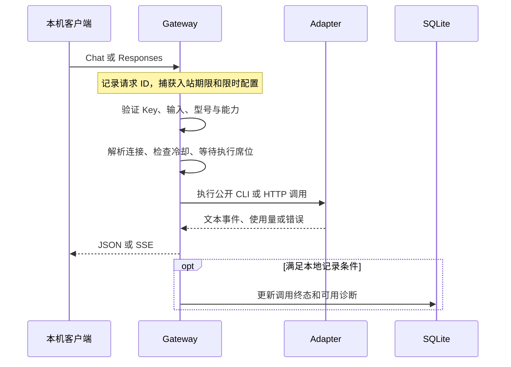

# Gateway 请求生命周期

1. 入站经过 `crates/gateway/src/execution.rs`，总预算 1200 秒覆盖认证、路由、排队、执行及响应消费。Key 仅认证本地网关，允许的型号和连接由 scope、路由与连接限制共同决定。目录中的未知能力保留来源及有效期。
2. Chat 按单次输入执行。Responses 可通过 `previous_response_id` 在同一 Key 下查找映射，按各 Adapter 已声明的续接能力执行，具体约束见 [Responses API](../api/RESPONSES_API.md)。
3. 对 Agent 连接串行派发，排队上限 30 秒，两次开始间隔至少 5 秒。CLI 空闲限时按入站捕获的设定执行，范围 30–1200 秒。HTTP Adapter、RPC 和桌面客户端各有独立期限。
4. Qoder CLI 的明确首包超时信号可归类为上游首包超时。有界 stderr 用于判定。连接冷却期间的拒绝返回剩余等待、原因与未发出标记。未分类的上游失败保留通用错误语义。
5. Gateway 将文本及可信元数据投影到标准响应。SSE 的有界生产者在期限或断开时释放本机执行资源。远端取消与计费依各运行时证据，不能从本机回收状态推定。
6. 调用历史默认保存元数据，正文需用户先打开录制；`store:false` 禁止本次本地持久化。对外错误和日志使用安全错误码与关联 ID。相关记录见[会话模型](SESSION_MODEL.md)。

接口、计时层、错误形状及前端可见字段见 [OpenAI 兼容 API](../api/OPENAI_COMPAT.md)、[流式契约](../api/STREAMING.md)和[错误模型](../api/ERROR_MODEL.md)。
